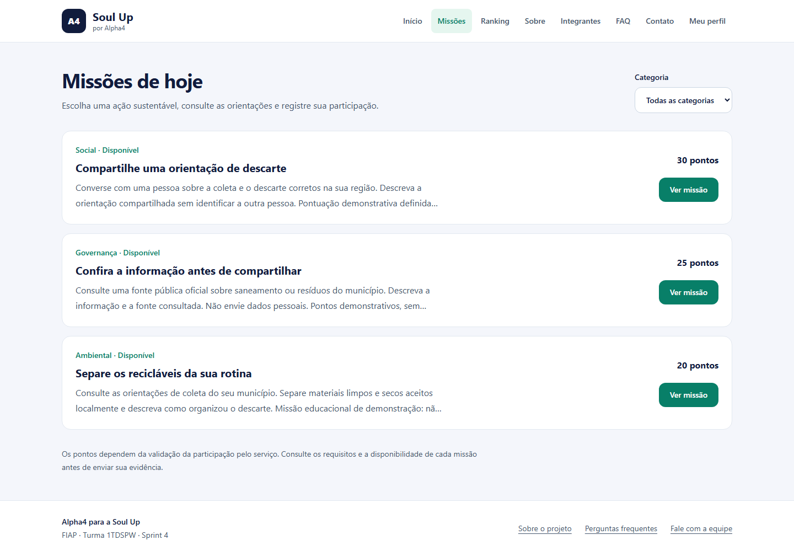

# Alpha4 para a Soul Up

Frontend da Sprint 4 da FIAP: uma experiência de gamificação para hábitos
sustentáveis, com missões, envio de evidência textual e rankings. Desenvolvido
do zero em React + Vite + TypeScript, com Tailwind CSS.

## Estado da entrega

A aplicação compila e a integração com a API Spring Boot foi verificada
localmente, incluindo listagem, detalhe, envio e aprovação de evidência,
ranking, atualização e exclusão de perfil. Revisões independentes conferiram
o código, os testes e as capturas nas diferentes resoluções.
O frontend está publicado na Vercel e a API Spring Boot está publicada no Render.
Os links individuais foram atualizados com os endereços indicados pelo grupo.
As cinco fotos foram recuperadas
do frontend da Sprint 3 fornecido pela equipe.

## Tecnologias utilizadas

- React e React Router: componentes, contexto e navegação SPA.
- TypeScript: interfaces, unions, intersections e validação de respostas.
- Vite: desenvolvimento e build.
- Tailwind CSS: toda a estilização e responsividade.
- `fetch` nativo: comunicação REST, cancelamento e tempo limite.
- Vitest e Testing Library: fluxos e tratamento de falhas.
- Playwright: navegação e responsividade em navegador real.

As versões exatas estão em `package-lock.json`. Não são utilizados UI kits,
Axios ou templates prontos.

## Como usar

| Recurso            | Endereço                                            |
| ------------------ | --------------------------------------------------- |
| GitHub do frontend | https://github.com/proc0x41/chellengesprints-alpha4 |
| GitHub da API Java | https://github.com/proc0x41/challengesprints-java   |
| Frontend na Vercel | https://chellengesprints-alpha4.vercel.app/         |
| API Java publicada | https://challengesprints-java.onrender.com/api      |

### Executar localmente

Requisitos: Node.js 24 LTS e npm. O projeto foi verificado com Node 24.11.1.

```bash
npm ci
```

Copie `.env.example` para `.env` e ajuste `VITE_API_URL` para a URL da API,
incluindo `/api`. Para o backend local, use `http://localhost:8080/api`.
Reinicie o Vite após mudar a configuração.

```bash
npm run dev
```

Abra o endereço exibido pelo Vite. A API deve permitir a origem desse endereço
em sua configuração de CORS. A documentação Java explica como iniciar o backend.
Não coloque chave administrativa ou outro segredo em variáveis `VITE_`: elas
são públicas no navegador.

```bash
npm run build
npm run preview
```

### Usar a solução

1. Acesse **Meu perfil** e crie um perfil com apelido, estado e comunidade opcional.
2. Acesse **Missões**, escolha uma categoria e abra uma missão.
3. Descreva a ação realizada e envie sua participação para análise.
4. Após aprovação pelo serviço responsável, acompanhe a pontuação no **Ranking**.

O token fica no `sessionStorage` desta aba. Esta versão não implementa senha ou
recuperação de acesso: encerrar a sessão pode impedir o gerenciamento posterior
do perfil. Use apenas apelidos de demonstração, sem informações sensíveis.
Excluir o perfil solicita a remoção dos registros no backend.

O formulário de contato abre o aplicativo de e-mail do visitante; ele não envia
nem armazena mensagens por conta própria.

### Rotas

| Caminho          | Função                                             |
| ---------------- | -------------------------------------------------- |
| `/` e `/home`    | Início; `/home` redireciona para `/`               |
| `/sobre`         | Problema, proposta e escopo                        |
| `/integrantes`   | Dados da equipe                                    |
| `/faq`           | Perguntas frequentes                               |
| `/contato`       | Contato por integrante                             |
| `/missoes`       | Listagem e filtro de missões                       |
| `/missoes/:id`   | Detalhe e envio de evidência da missão selecionada |
| `/ranking`       | Rankings por abrangência                           |
| `/conta`         | Criação, edição e exclusão do perfil               |
| Outros endereços | Página de recuperação com links de retorno         |

### Verificar e gerar o ZIP

```bash
npm test
npx playwright install chromium
npm run test:e2e
npm run build
npm run package
```

A suíte padrão verifica a navegação em 360, 480, 768, 992 e 1440 px. O teste
de integração real é habilitado separadamente e usa um backend de teste:

```powershell
$env:E2E_API_URL='http://localhost:8080/api'
$env:E2E_ADMIN_KEY_FILE='C:/caminho/local/chave-de-teste.txt'
npm run test:e2e
```

O arquivo deve conter apenas a chave administrativa do **ambiente de teste**.
Não o versione. Esse teste cria seus próprios perfis e missão, verifica
acompanhamento de amigos e moderação e remove os registros ao terminar.
Sem as duas variáveis, o teste real é explicitamente ignorado; uma suíte
verde nesse modo não comprova a integração com a API.

O empacotamento exige uma árvore Git limpa e gera
`entregas/alpha4-frontend.zip` com os arquivos versionados, sem `node_modules`,
sem segredos locais e com limite de 50 MB. O ZIP deve ser conferido e enviado
**exclusivamente pelo Portal do Aluno**, dentro do prazo.

## Estrutura de pastas

```text
src/
  components/   layout e estados de interface
  context/      sessão e avisos compartilhados
  data/         integrantes e unidades federativas
  hooks/        consultas com cancelamento e recuperação
  pages/        páginas e jornadas da solução
  services/     fetch, autenticação e validação do contrato Java
  test/         configuração dos testes
  types/        modelos de apresentação tipados
public/images/  protótipo visual e fotos dos integrantes
e2e/            testes em navegador
scripts/        empacotamento da entrega
docs/           contrato e fluxo de versionamento
```

## Autores e créditos

Todos os integrantes são da turma **1TDSPW**. Nomes e RMs seguem o documento
`Alpha4_Sprint3.pdf`, fornecido pela equipe.

| Nome completo                   | RM     | Contato              | Foto                                                                                        | GitHub                                       | LinkedIn                                                             |
| ------------------------------- | ------ | -------------------- | ------------------------------------------------------------------------------------------- | -------------------------------------------- | -------------------------------------------------------------------- |
| Vinicius de Oliveira            | 561862 | rm561862@fiap.com.br |            | [GitHub](https://github.com/Vinicius-0lvr)   | [LinkedIn](https://www.linkedin.com/in/vinicius-oliveira-101137252/) |
| Robison Custodio Junior         | 572866 | rm572866@fiap.com.br |          | [GitHub](https://github.com/Junior4744)      | [LinkedIn](https://www.linkedin.com/in/robinson-custodio-junior/)    |
| Lucas Fernando Silva            | 564848 | rm564848@fiap.com.br |              | [GitHub](https://github.com/lucas-silva8077) | [LinkedIn](https://www.linkedin.com/in/lucas-fernando-5aa8b6193/)    |
| Thiago Shimizu Sodré dos Santos | 572867 | rm572867@fiap.com.br |  | [GitHub](https://github.com/thssd)           | [LinkedIn](https://www.linkedin.com/in/thiagoshimizusodre/)          |
| Arthur Mendes Garcia            | 571703 | rm571703@fiap.com.br |             | [GitHub](https://github.com/proc0x41)        | [LinkedIn](https://www.linkedin.com/in/arthur-mendes-garcia/)        |

As fotos vêm do projeto da Sprint 3; os endereços individuais foram indicados
posteriormente pelo grupo.
O histórico utiliza Conventional Commits em português, com rodízio de
identidades locais solicitado pela equipe. Veja [GitFlow](docs/GITFLOW.md).

### Registro de assistência de IA

Codex foi utilizado para implementação, testes e revisão com agentes. A equipe
é responsável por revisar, compreender e validar os arquivos e as regras antes
da apresentação. Metadados de autoria configurados no Git não substituem essa revisão.

## Imagens e ícones relacionados ao projeto



Captura real desta implementação, produzida com perfil de demonstração e
backend local. Outras resoluções e jornadas estão em `docs/screenshots/`.
As capturas não comprovam publicação em nuvem.

O arquivo original `public/images/missoes-sprint3.png` foi extraído da página
13 do PDF da equipe e preservado como referência. A página inicial utiliza
`public/images/missoes-prototipo-revisado.png`, editado com ImageGen para
separar os títulos das pontuações e corrigir a sobreposição do original.
O prompt da edição acompanha a imagem no arquivo `.prompt.txt`.
Os valores do protótipo são ilustrativos, não dados de uma conta real.
As fotos em `public/images/team/` foram copiadas sem alteração de
`sprint3-front/challeger-alpha4/public/img/`. A associação entre foto e nome
segue `src/routes/Integrantes/index.tsx` desse projeto, inclusive a foto
`junior.jpeg`, identificada ali como Junior Custodio, para Robison Custodio Junior.
A interface utiliza
controles textuais e nativos do navegador, sem pacote de UI ou ícones externos.

## Contato

Utilize os e-mails dos integrantes na tabela acima ou a página `/contato`.
